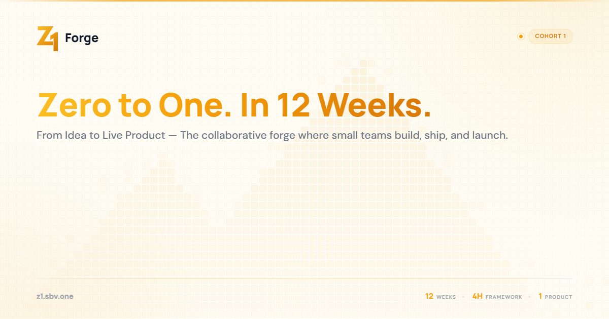

# SBV Z-One MVP Bootcamp (Z1 Forge)

[](LICENSE)


The web platform for **Z1 Forge**, the SBV Z-One MVP Bootcamp run by Starting Block Ventures: a 12-week program in the Philippines where teams of four founders build and ship their first MVP. It covers the public program site, individual and team applications, mentor applications, a member dashboard with weekly progress and challenges, and an admin panel for reviewing applications and managing and scoring teams.

**Live site:** [z1.sbv.one](https://z1.sbv.one)



## Overview

SBV Z-One MVP Bootcamp (`z1.sbv.one`) is a Next.js application with public pages, a member portal and an admin portal. Teams of 4 (Hacker, Hustler, Hipster, Hound — the "4H framework") apply, get accepted, and follow a structured 12-week curriculum. Admins review applications, manage teams and scores, and monitor the cohort.

## Features

### Public
- Program landing page, About, Blueprint, and the 12-week program (`/program`, with per-week pages; `/curriculum` redirects there)
- Application form for individuals and full teams (resume, LinkedIn and portfolio fields)
- Mentor application form
- 4H role quiz
- Team directory and team pages
- Collaborate page (investors, accelerators, grant providers, companies) and Contact page
- Terms and Privacy pages

### Participants (Members)
- Team dashboard with weekly progress
- The current week's challenge
- Links to the team page and the SBV mentor site

### Admin
- Dashboard with cohort stats, recent applicants and mentor applications
- Application review and management
- Team management and scoring

Confirmation emails (application, team application, mentor application, contact inquiry) are sent over SMTP using React Email templates.

## Tech Stack

| Category | Technology |
|---|---|
| Framework | Next.js 16 (App Router), React 19, TypeScript |
| Database | PostgreSQL, Prisma ORM (v7, `@prisma/adapter-pg`) |
| Auth | NextAuth v4 (credentials, JWT) |
| Styling | Tailwind CSS v4, shadcn/ui, Manrope + DM Sans + Geist Mono |
| Email | Nodemailer (SMTP), React Email |
| File Uploads | UploadThing |
| Analytics | PostHog |
| Testing | Vitest, Playwright (E2E) |
| Deployment | Vercel |

## Getting Started

### Prerequisites

- Node.js 20.9+ (required by Next.js 16)
- PostgreSQL database

### Installation

```bash
npm install
```

`postinstall` runs `prisma generate`.

### Environment Variables

Copy `.env.example` to `.env.local` (the Prisma config, the seed script and Next.js all read `.env.local`):

```env
DATABASE_URL=
NEXTAUTH_SECRET=
NEXTAUTH_URL=
UPLOADTHING_TOKEN=
MAIL_SERVER=
MAIL_PORT=
MAIL_USERNAME=
MAIL_PASSWORD=
MAIL_FROM=
MAIL_FROM_NAME=
MAIL_SSL_TLS=
NEXT_PUBLIC_POSTHOG_KEY=
NEXT_PUBLIC_POSTHOG_HOST=
ADMIN_SEED_PASSWORD=
MEMBER_SEED_PASSWORD=
```

PostHog is optional. `ADMIN_SEED_PASSWORD` and `MEMBER_SEED_PASSWORD` are required by the seed script.

### Database Setup

```bash
npx prisma migrate dev
npm run seed
```

### Development

```bash
npm run dev
```

Open [http://localhost:3000](http://localhost:3000).

### Production Build

```bash
npm run build   # prisma generate && next build
npm start
```

### Lint

```bash
npm run lint
```

## Project Structure

```
src/
├── app/
│   ├── admin/          # Admin portal (login, dashboard, applications, teams)
│   ├── apply/          # Individual and team application form
│   ├── program/        # 12-week program and per-week pages
│   ├── curriculum/     # Redirects to /program
│   ├── blueprint/      # Program blueprint
│   ├── teams/          # Team directory and team pages
│   ├── mentor/         # Mentor application form
│   ├── quiz/           # 4H role quiz
│   ├── dashboard/      # Member dashboard
│   ├── collaborate/    # Partner / investor page
│   ├── about/  contact/  privacy/  terms/
│   └── api/            # API routes (auth, apply, teams, dashboard, admin/*, uploadthing, ...)
├── components/         # Shared UI (shadcn/ui in components/ui) and page sections
├── emails/             # React Email templates
├── lib/                # Prisma client, data layer, auth, mail, rate limit, validators
├── tests/              # unit/, integration/ (Vitest), e2e/ (Playwright), helpers/
└── types/

prisma/
├── schema.prisma
├── migrations/
├── seed.ts             # npm run seed
└── clear.ts

scripts/                # One-off asset generators (Python .pptx deck, Puppeteer PDF);
                        # not wired into npm scripts and need their own dependencies
```

## Testing

```bash
# Unit and integration tests (Vitest)
npm test
npm run test:coverage

# E2E tests (Playwright; needs a running app and a seeded database)
npm run test:e2e
```

The admin E2E tests read `TEST_ADMIN_EMAIL` and `TEST_ADMIN_PASSWORD` from the environment.

## License

The code is released under the [MIT License](LICENSE). MIT covers the code; the Z1 Forge and SBV names and logos identify the project.
